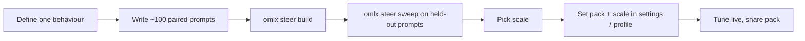

# Directional steering

Steering shifts a model's behaviour at inference time by editing activations along a direction learned from paired prompts — no fine-tuning, reversible per request. A **pack** holds one unit vector per layer plus a manifest; you set a pack and a scale on a loaded model, and the effect applies to new generations. The implementation follows `docs/experimental/directional-steering-plan.md`.

## Workflow



## Commands

`build`, `sweep`, `verify`, `set` and `show` talk to a running oMLX server; `list`, `import` and `export` work on local pack files under `<base_path>/steering/`.

| Command | Does |
|---|---|
| `omlx steer build MODEL --good-file G --bad-file B --name N [--component ffn\|attn] [--system S] [--think] [--pair-normalize] [--no-orthogonalize]` | Uploads paired prompts, the server captures activations on the live engine and writes the pack |
| `omlx steer sweep MODEL --pack N --prompts P [--scales "-1,-0.5,0,0.5,1,2"] [--tokens 180] [--nothink]` | Generates at each scale and prints text + word counts; restores the original settings afterwards. Changes the engine-wide scale — run on an idle server |
| `omlx steer verify MODEL --pack N [--scopes prefill+k] [--scales "-0.5,-1"] [--quick]` | Quality gate: neutral-text KL, NLL, repetition, JSON validity and (full mode) MMLU/GSM8K/HumanEval/TruthfulQA; writes results and the recommended scale into the pack manifest |
| `omlx steer set MODEL [--ffn F] [--attn A] [--pack N\|--off]` | Sets pack and scales (live push when only scales change) |
| `omlx steer show MODEL` | Live state: pack, scales, scope, method, salt, debug hits |
| `omlx steer list [--model M]` | Local packs, marked compatible with a model directory |
| `omlx steer export NAME -o x.zip` / `omlx steer import SRC [--name N]` | Share packs (zip, directory, HF repo, bare DS4 `.f32`) |

Prompt files take one prompt per line; `#` lines are comments.

## Best practices

| Practice | Why |
|---|---|
| Pairs ask for the same content and differ only in the target attribute | otherwise the vector learns topic |
| 50–150 pairs with varied topics | averaging cancels noise |
| Build with the same system prompt and thinking mode as production | activations at the last token depend on the template |
| FFN first, attention at 0 | attention vectors are fragile |
| Sweep `-1 … 2` at `temperature=0` on held-out prompts | `≤ -2` tends to repeat; greedy isolates the effect |
| Repetition, ignored prompts, lost facts → reduce `\|s\|` by ~30% | the scale is too strong |
| Rebuild per model and per quant | vectors are tied to the weights |
| Use profiles ("Terse", "Verbose") to switch setups | profile = named steering setup |
| Scale 0 instead of removing the pack | instant re-enable; shares cache with unsteered runs |

## Quality and performance gates

`omlx steer verify` applies the plan's §2e gates (KL ≤ 0.05 nats/token, NLL ≤ +2%, no structure drop, repetition within +1 pt, benchmark drops within their budgets) and records `quality[]` plus `usage.recommended` in the pack manifest. `benchmarks/steering_bench.py` records decode/prefill tok/s and the MTP speedup for no-pack, pack-at-0 and each scope, and applies the §2b regression gates.

## Running it on your Mac

The Linux CI container runs the logic tests only; capture, sweep, verify and the bench need a real model on Apple Silicon. The `steering_*.sh` wrappers boot an isolated server just in time, run one stage end to end, and clean up after themselves — one command each:

```bash
# Decided target: Qwen3.8-Flash-Next (qwen4_exp). Pin the model — the
# auto-detector scans ~/.omlx first and these models live in ~/.models.
# On qwen4_exp the FFN branch hook is inert at ±2; the attention branch
# hook works, so the pack is built with --component attn.
M=/Users/undici77/.models/Jundot/Qwen3.8-Flash-Next-oQ4e-mtp

# 1. Build the pack — DS4 verbosity prompts (good = succinct, bad = verbose),
#    20 pairs to start; drop --max-pairs to use all 100
./steering_build.sh --component attn --max-pairs 20 --name terse-q38-attn \
  --model-dir "$M"

#    ...or your own paired prompts (full paths; one prompt per line, # comments)
./steering_build.sh --component attn --name terse-q38-attn --model-dir "$M" \
    --good-file /path/to/succinct.txt --bad-file /path/to/verbose.txt

# 2. Effect sweep on held-out prompts (word counts per scale; the wrapper
#    reads the pack's component from its manifest)
./steering_effect.sh --pack terse-q38-attn --model-dir "$M" --scales -1,0

# 3. Quality gate (quick = KL + repetition + structure, in minutes)
./steering_verify.sh --pack terse-q38-attn --model-dir "$M" --quick

# 4. Performance gates (decode/prefill tok/s, MTP speedup; report JSON gitignored)
./steering_bench.sh --pack terse-q38-attn --model-dir "$M" --component attn --scale -1 --mtp-check

# 5. Keep it: set the pack + chosen scale (persisted in model settings)
.venv-macos/bin/omlx steer set <model> --pack terse-q38-attn --attn -1
```

Each wrapper takes `--model-dir DIR` (auto-detected from your configured model dirs when omitted) and `--base-path` (default `~/.omlx`); `steering_verify.sh` copies `quality[]` and the recommended scale back into the real pack manifest. The underlying commands also work directly against a running server — see the table above.

Reports (`steering_report_*.json`) are gitignored. Fast logic tests run anywhere: `PYTHONPATH=. python -m pytest tests/test_steering_core.py tests/test_steering_cli.py tests/test_steering_quality.py tests/test_steering_bench.py -q`; the numeric and real-model tests need the Mac (see [TESTING.md](TESTING.md)).
