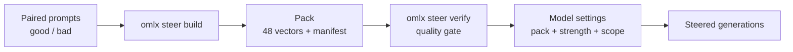

# Directional steering (experimental)

## TL;DR

Steering pushes a model's hidden states along a direction learned from paired prompts (for example terse vs verbose answers), with no fine-tuning and a strength you can change live. Experimental, **Qwen3.8 Flash Next (`qwen4_exp`) only**; measurements are in [experimental/directional-steering.md](experimental/directional-steering.md).

## How it works

A **pack** holds one unit vector per decoder layer plus a manifest. `omlx steer build` runs your "good" and "bad" prompts through the loaded model, records each layer's branch output, and stores the normalized difference of the means. At inference the hook removes (or adds) that component from the branch output, scaled by the strength you set.



## Quick start

The model must be loaded on a running server. The bundled preset uses the 100 succinct/verbose prompt pairs from [antirez/ds4](https://github.com/antirez/ds4) (MIT).

```bash
M=Qwen3.8-Flash-Next-oQ4e-mtp                  # model id on the server

omlx steer build  $M --preset verbosity --name terse   # ~1 min
omlx steer sweep  $M --pack terse --scales "-1,-0.5,0" # word counts per strength
omlx steer verify $M --pack terse --quick              # KL / NLL / repetition / JSON at -0.5 and -1
omlx steer set    $M --pack terse                      # uses the verified strength
```

Or pick the pack in the web UI: **Model settings → Experimental → Directional steering**.

## Settings

| Setting | Values | Default | Applies |
|---|---|---|---|
| `steering_pack` | pack name under `~/.omlx/steering/`, a pack directory or a DS4 `.f32` | none (off) | reloads the model |
| `steering_attn_scale` / `steering_ffn_scale` | -100 … 100 (useful range about -2 … 2) | the pack's recommended value, else 1 | live |
| `steering_scope` | `prefill+k`, `prefill`, `all` | `prefill+k` | live |
| `steering_decode_tokens` | 1 … 4096 (the K of `prefill+k`) | 32 | live |
| `steering_method` | `project`, `retarget` | `project` | live |
| `steering_norm_preserve` | true / false | false | live |

Negative strength pushes toward the pack's "good" side: with the `verbosity` preset, `-1` gives shorter answers. On Qwen3.8 only the attention branch (`attn`) steers measurably, so `build` uses it by default.

## Scopes

| Scope | Steered tokens | Decode cost on Qwen3.8 | Use when |
|---|---|---|---|
| `prefill+k` | the prompt and the first K generated tokens | none measurable | default; the effect carries through the rest of the answer |
| `prefill` | the prompt only | none expected | weakest effect |
| `all` | every token | about 5% slower decode | strongest effect |

## CLI

`build`, `sweep`, `verify`, `set` and `show` talk to a running server; `list`, `import` and `export` work on local pack files.

| Command | Does |
|---|---|
| `omlx steer build MODEL (--preset verbosity \| --good-file G --bad-file B) --name N` | Captures the prompts on the loaded model and writes the pack. Options: `--component attn\|ffn`, `--system S`, `--think`, `--pair-normalize`, `--no-orthogonalize` |
| `omlx steer sweep MODEL --pack N [--scales …] [--prompts P]` | Generates at each strength and prints the text and word counts, then restores the previous settings. It changes the engine-wide strength, so run it on an idle server |
| `omlx steer verify MODEL --pack N [--scales …] [--quick]` | Quality gate; writes the results and the recommended strength into the pack manifest |
| `omlx steer set MODEL [--pack N \| --off] [--attn A] [--ffn F]` | Sets the pack and strengths |
| `omlx steer show MODEL` | Live state: pack, strengths, scope, cache salt |
| `omlx steer list [--model DIR]` | Local packs, marked compatible with a model directory |
| `omlx steer export N -o pack.zip` / `omlx steer import SRC [--name N]` | Share packs (zip, directory, Hugging Face repo, DS4 `.f32`) |

Prompt files hold one prompt per line; lines starting with `#` are comments.

## Quality gate

`verify` compares each strength against the unsteered model. A strength is recommended only if every row passes.

| Check | Measures | Passes if |
|---|---|---|
| KL | next-token distribution shift on ~200 neutral paragraphs | ≤ 0.05 nats/token |
| NLL | perplexity change on the same paragraphs | ≤ +2% |
| Repetition | share of repeated 4-grams in generations | rise ≤ 1 point |
| Structure | valid-JSON rate on structured prompts | no drop |
| Benchmarks (full mode only) | MMLU, GSM8K, HumanEval, TruthfulQA | drop within 1–2 points |

## Writing your own pairs

| Practice | Why |
|---|---|
| Each pair asks for the same content and differs only in the target trait | otherwise the vector learns the topic |
| 50–150 pairs on varied topics | averaging cancels noise |
| Build with the system prompt and thinking mode you serve with | the activations depend on the template |
| Sweep on held-out prompts before keeping a strength | the build prompts overstate the effect |
| Repetition or ignored instructions → reduce the strength by about a third | the push is too strong |
| Set strength 0 instead of removing the pack | no reload; the prompt cache is shared with unsteered runs |

## Limits

| Limit | Detail |
|---|---|
| Model support | `qwen4_exp` only; setting a pack on another model is refused |
| Engine-wide | one pack and strength per model, applied to every request |
| Prompt cache | steered and unsteered prompts never share cache blocks (pack, strength and scope are part of the cache key) |
| Pack per model | vectors are valid only on the model and quantization they were built on |
